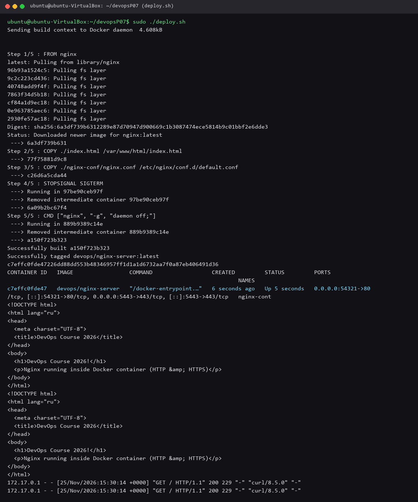
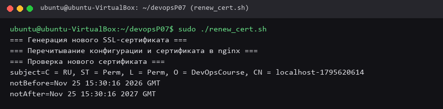

# П07. Docker basics. Nginx в контейнере (HTTP/HTTPS + Volume + Reload)

## Описание работы
Практическая работа №7 по курсу DevOps:
1. Установлен `docker.io` (и настроено зеркало `https://dockerhub.timeweb.cloud` в `/etc/docker/daemon.json`).
2. Подготовлен `dockerfile` на базе официального образа `nginx`, копирующий приветственную HTML-страницу `index.html` и конфигурацию `nginx.conf`.
3. Написан скрипт `deploy.sh`, который при отсутствии генерирует самоподписанный SSL-сертификат, пересобирает образ `devops/nginx-server` и запускает контейнер `nginx-cont` с пробросом портов `54321:80` (HTTP) и `5443:443` (HTTPS) и монтированием каталога `./ssl` через Volume Mapping (`-v $(pwd)/ssl:/etc/nginx/ssl:ro`).
4. Выполнено дополнительное задание: реализован скрипт `renew_cert.sh` для пересоздания SSL-сертификата на хосте и перечитывания конфигурации внутри работающего контейнера командой `docker exec nginx-cont nginx -s reload`.

## Структура репозитория
* `README.md` — описание выполненной работы и отчёт со скриншотами.
* `deploy.sh` — скрипт сборки образа, запуска контейнера и проверки портов.
* `renew_cert.sh` — скрипт обновления SSL-сертификата с последующим `nginx -s reload`.
* `nginx/dockerfile` — Dockerfile для сборки образа веб-сервера Nginx.
* `nginx/index.html` — статическая HTML-страница с приветствием.
* `nginx/nginx-conf/nginx.conf` — конфигурация Nginx для HTTP (80) и HTTPS (443).
* `screenshots/` — скриншоты сборки, запуска контейнера, HTTP/HTTPS-ответов и обновления SSL-сертификата.

---

## Ход выполнения работы и результаты

### 1. Сборка образа, запуск контейнера и проверка портов `54321` / `5443`
Скрипт `./deploy.sh` собрал образ `devops/nginx-server`, запустил контейнер `nginx-cont` и проверил доступность по HTTP (`54321`) и HTTPS (`5443`):

---

### 2. Обновление SSL-сертификата через Volume Mapping и `nginx -s reload`
Скрипт `./renew_cert.sh` пересоздал сертификат в примонтированном каталоге `./ssl`, выполнил `docker exec nginx-cont nginx -s reload` и подтвердил новый `Subject` через `openssl s_client`:

